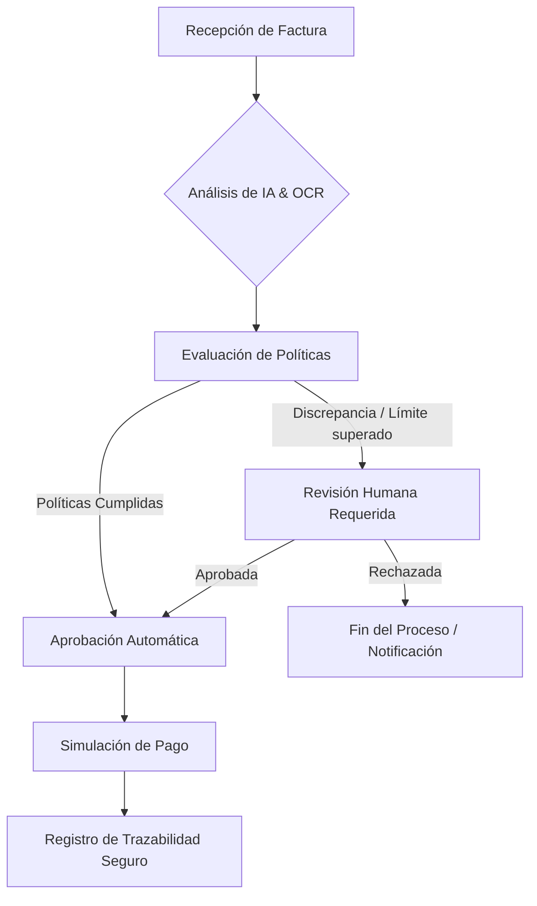

# 🛡️ Blinka Payguard

**Prototipo para el Reto Blinka - Hackathon 30X**

[](https://blinka-payguard.vercel.app)
[]()

Blinka Payguard es una solución automatizada e inteligente diseñada para transformar el flujo de revisión y aprobación de facturas. Combina el poder de la Inteligencia Artificial con validación humana estratégica para garantizar pagos seguros, transparentes y completamente trazables.

---

## 💡 La Solución
La validación manual de facturas es lenta y propensa a errores. Blinka Payguard resuelve esto implementando un sistema de validación híbrido (IA + Humano) que aplica reglas de negocio estrictas antes de ejecutar cualquier simulación de pago. 

## ✨ Características Principales
*   **🧠 Revisión de Facturas con IA:** Extracción automatizada de datos y análisis del contenido de las facturas para detectar discrepancias, fraudes o errores de formato.
*   **⚙️ Políticas Configurables:** Motor de reglas adaptable que permite definir límites de gastos, proveedores restringidos y condiciones de aprobación personalizadas.
*   **🧑‍💻 Aprobación Humana (Human-in-the-Loop):** Interfaz intuitiva para que los supervisores revisen, aprueben o rechacen las facturas que la IA marca como dudosas o que superan umbrales específicos.
*   **💸 Pagos Simulados con Trazabilidad:** Ejecución de pagos en un entorno controlado con un registro inmutable y detallado de cada paso del proceso para facilitar auditorías.

## 🌐 Demo en Vivo
Prueba el prototipo funcional directamente aquí: **[blinka-payguard.vercel.app](https://blinka-payguard.vercel.app)**

## 🛤️ Flujo del Sistema



## 🛠️ Tecnologías Utilizadas
*(Nota: Ajusta este stack según las herramientas exactas que usaron)*
*   **Frontend:** React / Next.js / Angular (Desplegado en Vercel).
*   **Backend:** Node.js / Express.
*   **IA:** Integración LLM para análisis de texto y extracción de datos.
*   **Base de Datos / Trazabilidad:** PostgreSQL / MySQL.

## ⚙️ Configuración y Despliegue Local

1. **Clonar el repositorio:**
   ```bash
   git clone https://github.com/str26/blinka-payguard.git
   cd blinka-payguard
   ```
2. **Instalar dependencias:**
   ```bash
   npm install
   ```
3. **Variables de entorno:**
   Crea un archivo `.env` en la raíz del proyecto y configura tus credenciales.
   ```env
   AI_API_KEY=tu_clave_aqui
   DATABASE_URL=tu_conexion_aqui
   ```
4. **Ejecutar en desarrollo:**
   ```bash
   npm run dev
   ```

---
*Desarrollado con 💻 y ☕ para el Reto Blinka de la Hackathon 30X.*