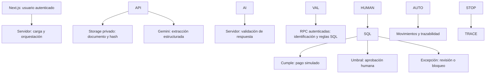

<p align="center">
  
</p>

# Blinka PayGuard

### De la factura a la decisión: autonomía con control.

**Un agente que revisa facturas, aplica las reglas de la empresa y completa pagos simulados cuando todo cumple. Si necesita autorización, se detiene, explica el motivo y espera una decisión humana.**

Prototipo independiente para el reto Blinka de **Hackathon 30X**. Combina extracción documental con Gemini, controles financieros en PostgreSQL y una interfaz **en español e inglés** que permite seguir cada factura hasta su resultado.

> \*\*Entorno de demostración:\*\* empresa, proveedores, acuerdos, facturas y saldos ficticios de Atlas Demo Global LLC. No hay conexión bancaria ni movimiento de dinero real.

[Evaluar la demo](#para-el-jurado-tres-casos-una-misma-promesa) · [Español / English](#internacionalización-i18n) · [Arquitectura](#arquitectura-y-responsabilidades) · [Instalación](#instalación-local) · [Pruebas](#pruebas-y-calidad) · [Despliegue](#despliegue-en-vercel)

**English overview:** PayGuard is a bounded invoice-processing agent: Gemini extracts structured data, PostgreSQL enforces company rules, and eligible invoices reach simulated payment. Exceptions require review or human approval. Select **English** on the landing page, sign-in page or dashboard; the preference persists on the same browser and domain. Explore the three demo PDFs below: automatic payment (USD 800), approval required (USD 1,500), and agreement mismatch (USD 900 against an USD 800 agreement). All balances and payments are fictional.

## Para el jurado: tres casos, una misma promesa

**La autonomía termina donde las reglas exigen intervención humana.** Estos tres documentos permiten comprobarlo con la misma aplicación y política USD:

|Caso|Documento incluido|Resultado esperado|Evidencia que revisar|
|-|-|-|-|
|Autonomía|[Factura de USD 800](./output/pdf/demo-auto-001.pdf)|`paid\_simulated` sin confirmar campos ni pulsar Pagar, si la extracción y los controles son válidos.|Traza del agente, comprobante, débito de wallet y gasto de presupuesto.|
|Control humano|[Factura de USD 1.500](./output/pdf/demo-approval-001.pdf)|`pending\_approval`; tras aprobación válida con motivo, el agente revalida y completa el pago simulado.|Actor, motivo, decisión vinculada y movimiento posterior.|
|Protección|[Factura de USD 900](./output/pdf/demo-block-001.pdf)|`blocked`: el acuerdo registrado es de USD 800.|Regla de discrepancia y ausencia de pago.|

**Antes de presentar:** instala las ocho migraciones, carga el seed, habilita el agente y crea el acuerdo `DEMO-USD-1500` con el script indicado abajo. Ten disponibles las cuentas `admin` y `approver`, un modelo Gemini compatible con cuota y al menos USD 2.300 disponibles tanto en wallet como en presupuesto para completar los dos pagos. Los resultados dependen también de una extracción válida; una advertencia o ambigüedad adicional puede llevar el caso a revisión.

**Recorrido sugerido:** abre `/dashboard`, carga AUTO en `/invoices`, muestra el resultado en el detalle, carga BLOCK y explica la discrepancia; termina con APPROVAL, la autorización humana y la continuación del agente. En cada detalle compara documento, extracción, reglas y trazabilidad. El [guion de demo](./docs/demo-runbook.md) incluye la secuencia y los saldos esperados.

**Comprobación bilingüe:** selecciona **English**, navega del dashboard a una factura y recarga. Comprueba que el idioma se conserva y que estados, importes y movimientos corresponden a la misma operación. En una aprobación pendiente, la acción se presenta como “Approve and continue with agent”; en un bloqueo por fondos, se muestran “Required”, “Available” y “Shortfall”. Cambia después a **Español**. Seleccionar idioma no ejecuta el agente ni genera pagos.

**Acceso reproducible:** sigue la [instalación local](#instalación-local) para abrir la aplicación en `http://localhost:3000`, o utiliza el [despliegue en Vercel](#despliegue-en-vercel) con tus servicios configurados.

## El problema

Pagar una factura exige más que leer un PDF: identificar al proveedor, contrastar el acuerdo, detectar duplicados, aplicar límites y comprobar fondos y presupuesto. Hacer estas verificaciones por separado fragmenta el proceso y dificulta explicar por qué se pagó o se detuvo una operación.

Una automatización útil debe resolver las facturas rutinarias y reconocer sus límites: una discrepancia no puede convertirse en un pago solo porque un modelo lo sugiera o una persona apruebe el importe.

## La solución y su valor

PayGuard reúne recepción, extracción, decisión y seguimiento en un flujo por factura:

* **Lectura asistida:** Gemini devuelve campos estructurados con evidencias textuales; la aplicación valida su formato y señala datos incompletos o ambiguos.
* **Decisión verificable:** el servidor y PostgreSQL contrastan proveedor y acuerdo registrados, moneda, límites, fondos y presupuesto vigente.
* **Intervención cuando corresponde:** el sistema solicita aprobación por umbral o deriva excepciones a revisión. Aprobar no elimina los controles obligatorios.
* **Resultado explicable:** se pueden consultar datos, comprobaciones, actor, ejecución del agente, movimientos y comprobante de simulación.
* **Experiencia bilingüe:** español e inglés en el recorrido operativo, con selección persistente y mensajes financieros que conservan los valores monetarios.
* **Operación por moneda:** USD, COP y MXN tienen políticas y recursos independientes, sin conversión implícita.

El valor propuesto es reducir la revisión manual de casos elegibles y concentrar la atención en excepciones, conservando evidencia de la decisión. **El prototipo aún no mide ahorro de tiempo, precisión de extracción ni retorno económico.** Un piloto debería medirlos junto con la tasa de intervención y los errores detectados.

**Usuarios a los que puede servir:** responsables de cuentas por pagar, operadores y aprobadores que trabajan en español, inglés o equipos mixtos. La combinación de interfaz bilingüe y recursos independientes en USD, COP y MXN facilita presentar el prototipo a equipos de distintos mercados. Ese alcance de uso no acredita adopción comercial, conversión de divisas ni cumplimiento fiscal en otros países.

## Qué está implementado

|Capacidad|Implementación y punto de comprobación|
|-|-|
|Acceso por empresa y rol|Supabase Auth, membresías y RLS; roles `admin`, `operator` y `approver`.|
|Recepción documental|PDF, PNG o JPEG hasta 3 MiB, Storage privado y hash SHA-256.|
|Extracción con IA|Ocho campos con valor/evidencia y advertencias: número, nombre y código de proveedor, acuerdo, importe, moneda, emisión y vencimiento.|
|Agente de flujo acotado|Extracción → identificación → reglas → pago simulado o intervención humana.|
|Controles transaccionales|Revalidación, reservas, idempotencia y bloqueos de base de datos.|
|Supervisión|Dashboard, facturas, detalle documental, reglas y auditoría; políticas en modo de consulta.|
|Reembolsos recibidos simulados|Registro parcial o total sobre un pago, con motivo y controles de importe.|
|Internacionalización ES / EN|Selector de idioma persistente, mensajes financieros localizados y formatos de presentación por idioma.|
|Material reproducible|Tres PDF básicos, generadores y verificaciones locales/SQL.|

## Internacionalización (i18n)

El usuario puede seleccionar **Español** o **English** desde la presentación, el acceso y la barra superior del panel. La cobertura incluye navegación, dashboard, carga y listado de facturas, detalle, reglas, traza del agente, revisión, aprobación, cancelación, reintentos y reembolsos, además de mensajes conocidos de validación y error.

|Aspecto|Comportamiento implementado|
|-|-|
|Idioma inicial|Español; preferencias distintas de `es` o `en` vuelven a español.|
|Persistencia|Cookie `payguard-locale=es\|en`, con vigencia de un año y alcance al dominio. Localhost y Vercel conservan preferencias independientes.|
|Cliente y servidor|El selector actualiza la interfaz y refresca los componentes de servidor; `html lang` y metadatos siguen la preferencia.|
|Importes y fechas|Formatos de presentación `es-CO` / `en-US` en el dashboard y fechas localizadas en auditoría/comprobantes; zona operativa `America/Bogota`. Los formularios conservan importes decimales con punto.|
|Mensajes financieros|Los textos conocidos y mensajes de insuficiencia se presentan en el idioma seleccionado, preservando moneda, requerido, disponible y faltante.|
|Evidencia original|Nombres, archivos, números, referencias, evidencias documentales y motivos humanos conservan su contenido original. Los textos no reconocidos se muestran literalmente.|

Por ejemplo, un bloqueo puede mostrarse como:

> Insufficient funds. Required: USD 1500.00. Available: USD 1300.00. Shortfall: USD 200.00. No payment was executed.

La localización utiliza un [catálogo inglés](./src/lib/i18n/en.json), un [traductor de presentación](./src/lib/i18n/translate.ts), un [proveedor cliente](./src/lib/i18n/provider.tsx) y [lectura de preferencia en servidor](./src/lib/i18n/server.ts). No incorpora un servicio externo de traducción ni dependencias nuevas. **La selección de idioma no cambia políticas, permisos, estados, importes ni movimientos.**

Esta actualización no requiere variables de entorno ni migraciones SQL adicionales. Para una instalación nueva sigue el procedimiento completo; para una instalación existente con las ocho migraciones, basta desplegar el código actualizado y comprobar ES/EN. Detalles y comprobaciones: [guía i18n](./docs/i18n-010-setup.md).

## Arquitectura y responsabilidades



**Gemini extrae; PostgreSQL gobierna la operación.** El agente es una orquestación de flujo acotado: no utiliza un LLM con herramientas financieras libres. El documento y la respuesta del modelo se tratan como entradas no confiables. La presencia de una evidencia textual en la extracción no certifica la autenticidad del documento.

La sesión autenticada llega a las RPC financieras. La clave secreta se reserva para tareas de servidor como acceder al archivo privado y almacenar la extracción; no reemplaza la identidad de usuario que invoca el agente. La base de datos comprueba permisos, política y recursos antes de reservar o pagar, y serializa comandos financieros por empresa mediante un bloqueo transaccional.

La orquestación está en [`process-invoice.ts`](./src/modules/agent/server/process-invoice.ts); la extracción, en [`gemini.ts`](./src/modules/invoices/server/gemini.ts). La lógica operativa del agente se incorpora en la [migración 007](./supabase/migrations/202610170007_autonomous_agent.sql), con actualización de mensajes de insuficiencia en la [008](./supabase/migrations/202610170008_insufficient_funds_messages.sql). El evaluador TypeScript de [`decisions/domain`](./src/modules/decisions/domain/evaluate-invoice.ts) tiene pruebas propias; no es el ejecutor del pago SQL.

El procesamiento ocurre de forma **síncrona** en la petición: carga y extracción configuran `maxDuration=90`, y la llamada a Gemini tiene un timeout de 60 segundos. No hay cola duradera ni worker. Un fallo puede dejar el documento registrado con el procesamiento pendiente; el detalle permite reanudarlo, sujeto a los límites de intentos y sin volver a pagar facturas cerradas.

## Tecnologías

|Capa|Tecnología declarada en el repositorio|
|-|-|
|Runtime|Node.js 22.x y npm|
|Aplicación|Next.js 16.4.2, App Router y Route Handlers|
|Interfaz|React 19.3.1, TypeScript 7.0.2, CSS global y CSS Modules|
|Identidad y persistencia|Supabase Auth, PostgreSQL, RLS, RPC SQL y Storage privado|
|Internacionalización|Implementación propia ES/EN con catálogo JSON, contexto React y cookie leída por Next.js|
|Extracción|Gemini API mediante `fetch` desde el servidor|
|Pruebas|Node.js Test Runner, compilación TypeScript y scripts SQL|
|Despliegue documentado|Vercel para Next.js; Supabase para Auth, datos y archivos|

Versiones y scripts: [`package.json`](./package.json). Instalación reproducible de dependencias: [`package-lock.json`](./package-lock.json).

## Requisitos previos

* Node.js 22.x y npm.
* Un proyecto Supabase con acceso a SQL Editor, Auth, base de datos y Storage.
* Una clave de Google Gemini API con acceso a un modelo que admita documentos PDF e instrucciones de salida estructurada (`generateContent`).
* Dos usuarios de prueba creados en Supabase Auth: uno con rol `admin` y otro `approver`. También se admite `operator` para carga y revisión.

## Instalación local

1. Clona el repositorio y entra en su directorio:

```bash
   git clone https://github.com/str26/blinka-payguard.git
   cd blinka-payguard
   ```

2. Instala exactamente las dependencias del lockfile y crea el archivo local de variables:

```bash
   npm ci
   ```

   En Bash (Linux, macOS o Git Bash):

```bash
   cp .env.example .env.local
   ```

   En PowerShell:

```powershell
   Copy-Item .env.example .env.local
   ```

3. Completa `.env.local` con los valores del proyecto Supabase y Google AI Studio:

```dotenv
   NEXT\_PUBLIC\_SUPABASE\_URL=https://<project-ref>.supabase.co
   NEXT\_PUBLIC\_SUPABASE\_PUBLISHABLE\_KEY=<publishable-key>
   SUPABASE\_SECRET\_KEY=<secret-key-del-servidor>
   GEMINI\_API\_KEY=<clave-de-Gemini>
   GEMINI\_MODEL=<id-del-modelo-habilitado>
   ```

   `GEMINI\_MODEL` es el ID exacto del modelo, sin el prefijo `models/`. Puedes consultar los modelos visibles para la clave mediante `npm run list:gemini-models`. Que el modelo aparezca en el catálogo no garantiza cuota disponible.

   **No publiques `.env.local`, no subas claves a Git y nunca antepongas `NEXT\_PUBLIC\_` a `SUPABASE\_SECRET\_KEY` ni a `GEMINI\_API\_KEY`.** El prefijo `NEXT\_PUBLIC\_` expone una variable al navegador.

4. En Supabase SQL Editor, aplica **una sola vez y en orden** las migraciones de `supabase/migrations/`:

   1. `202610170001\_initial\_schema.sql`
   2. `202610170002\_transactions.sql`
   3. `202610170003\_invoice\_extraction.sql`
   4. `202610170004\_invoice\_review.sql`
   5. `202610170005\_terminal\_extraction\_guard.sql`
   6. `202610170006\_simulated\_refunds.sql`
   7. `202610170007\_autonomous\_agent.sql`
   8. `202610170008\_insufficient\_funds\_messages.sql`

   No vuelvas a ejecutar migraciones que ya estén aplicadas ni borres tablas para resolver un error. La aplicación y las funciones SQL deben corresponder a la misma versión.

5. Carga los datos ficticios ejecutando `supabase/seed.sql`. El seed es idempotente y no reinicia saldos existentes. Crea la empresa demo, proveedores, acuerdos base, políticas, wallets y presupuesto semilla para USD, COP y MXN. Los importes y límites son independientes por moneda: **no hay conversión de divisas**.
6. Prepara empresa, agente y usuarios:

   * Ejecuta `supabase/setup/enable\_demo\_agent.sql` para habilitar el agente solo en Atlas Demo Global LLC.
   * Ejecuta `supabase/setup/demo\_agreements.sql` para añadir el acuerdo ficticio USD 1.500 necesario para el caso de aprobación. El script comprueba lo que ya existe y no reinicia saldos.
   * En Supabase **Authentication → Users**, crea dos cuentas de prueba y confirma sus correos. Copia sus UUID de usuario Auth; no son el usuario Owner/Developer del dashboard de Supabase.
   * Sustituye los dos UUID prellenados en el script de `supabase/setup/assign\_demo\_members.sql` por los UUID reales y ejecútalo. Asigna `admin` y `approver` a la empresa ficticia. No habilites registro público ni concedas roles desde el navegador.

   Consulta [Auth](./docs/auth-setup.md) y [agente](./docs/agent-setup.md). Algunos documentos de `docs/` describen entregas anteriores; para una instalación completa sigue las ocho migraciones y el orden de este README.

7. Ejecuta también `supabase/tests/installation\_readiness.sql` en SQL Editor (solo lectura) y comprueba la configuración antes de iniciar:

```bash
   npm run check:services
   npm run check:mvp
   ```

   Son diagnósticos de configuración/esquema, no realizan una compra ni demuestran por sí solos una extracción real o permisos efectivos en todos los flujos. `check:mvp` requiere las variables del servidor, incluido `GEMINI\_MODEL`.

8. Arranca la aplicación:

```bash
   npm run dev
   ```

   Abre [http://localhost:3000](http://localhost:3000), inicia sesión en `/login` y entra al dashboard. Carga PDF, PNG o JPEG de **hasta 3 MiB**, un documento con una sola factura por carga. Usa documentos ficticios: el archivo se transmite a Google para su extracción.

   Usuarios de prueba:   
   | Usuario | Rol | Contraseña |
   | ------- | --- | ---------- |
   | admin@payguard.example | Administrador | Admin2026\* |
   | aprobador@payguard.example | Aprobador | Aprobador2026\* |

   Para ejecutar localmente la compilación de producción:

```bash
   npm run build
   npm start
   ```

### Saldos, políticas y periodo semilla

|Moneda|Saldo de wallet|Presupuesto|Umbral automático|Límite absoluto|
|-|-:|-:|-:|-:|
|USD|5.000|4.000|1.000|3.000|
|COP|20.000.000|16.000.000|4.000.000|12.000.000|
|MXN|100.000|80.000|20.000|60.000|

Son valores ficticios e independientes, sin equivalencia cambiaria. Los presupuestos corresponden a **octubre de 2026**. Cada operación previa puede reducir el disponible. El agente usa el presupuesto del periodo vigente en la zona `America/Bogota`; si se instala o se ejecuta en otro periodo, un administrador debe configurar el presupuesto correspondiente antes de probar pagos. No edites saldos ni borres movimientos para hacer pasar una demo.

## Estados y controles de decisión

|Resultado|Comportamiento|
|-|-|
|`authorized`|Cumple las reglas y tiene fondos reservados; todavía no significa que se haya pagado.|
|`paid\_simulated`|Pago ficticio registrado; muestra comprobante y movimiento. No se transfirió dinero.|
|`pending\_approval`|Supera el umbral automático; espera a un rol autorizado y motivo, sin reservar fondos. Al aprobar, vuelve a validar.|
|`needs\_review`|Campos incompletos/ambiguos o una excepción que requiere comprobación humana.|
|`blocked`|Incumple un control obligatorio, como proveedor registrado no permitido, discrepancia de acuerdo, límite absoluto o fondos/presupuesto insuficientes.|
|`cancelled`|Operación cancelada o rechazada; estado terminal de la factura.|

Los estados de entrada incluyen `received` y `processing`. En la evaluación de reglas la prioridad es **bloqueo → revisión → aprobación → autorización automática**; antes de ella, la identificación puede detener el flujo en revisión.

**Duplicados:** si los bytes son idénticos, el SHA-256 recupera la factura existente. Si cambia el archivo pero coincide proveedor y número, el agente puede enviarlo a `needs\_review`; además, una restricción de unicidad protege la identidad de factura por empresa. No se promete que todo duplicado produzca el estado `blocked`. La moneda debe coincidir con la política y los recursos disponibles; no se asume tipo de cambio. Los roles y los límites efectivos se verifican del lado del servidor y de PostgreSQL, no por lo que solicite el navegador o sugiera el modelo.

## Pruebas y calidad

Ejecuta desde la raíz:

```bash
npm run typecheck
npm test
npm run test:invoices
npm run test:review
npm run test:actions
npm run test:refunds
node --test tests/liquidity.test.mjs tests/i18n\*.test.mjs tests/retry-button-render.test.mjs
npm run build
```

* `npm test`: reglas y evaluación determinista del dominio.
* `test:invoices`: validación de extracción.
* `test:review`: confirmación de datos extraídos y revisión humana.
* `test:actions`: validación de solicitudes y disponibilidad de acciones según rol y estado; no ejecuta pagos SQL.
* `test:refunds`: validación de solicitudes de reembolso y cálculos exactos.
* Comando `node --test` adicional: mensajes de insuficiencia, catálogo bilingüe, componentes financieros en inglés, selección/persistencia del idioma y renderizado/comportamiento del botón de reintento. Requiere ejecutar antes una suite `test:invoices`, `test:review`, `test:actions` o `test:refunds` para compilar el dominio.
* `typecheck` y `build`: comprobación estática y compilación de producción.

**`npm test` ejecuta solo la suite de decisiones**, no todas las pruebas del repositorio. Las cinco suites npm suman 64 casos. Las pruebas adicionales suman 29: 6 de insuficiencia y 23 de i18n/componentes/preferencia/reintento, para un total de **93 casos locales**. Las comprobaciones de preferencia usan componentes con entorno simulado; no equivalen a una sesión real de navegador. La evaluación TypeScript no sustituye las reglas SQL que gobiernan la operación.

Los scripts SQL de `supabase/tests/` comprueban esquema, transacciones, extracción, revisión, agente y reembolsos en un entorno desechable. Pueden crear fixtures temporales: **no los ejecutes en producción**. `supabase/tests/installation\_readiness.sql` es una excepción de solo lectura para comprobar el despliegue actual. Las pruebas locales o con servicios simulados no sustituyen una prueba de integración con tu proyecto Supabase, clave Gemini y hosting reales.

**Verificación de esta revisión (17 de octubre de 2026):** sobre el código de `a9fe75489ba401c8301f93a6fe977026d8cdf008`, pasaron `typecheck`, los 93 casos locales y `build`. El entorno de comprobación usó Node.js 24.19.0; la versión declarada para instalación y despliegue sigue siendo 22.x. Esta revisión no ejecutó las verificaciones SQL ni una integración en vivo con Supabase, Gemini o Vercel.

## Despliegue en Vercel

1. Aplica las migraciones que falten, carga el seed, crea usuarios y membresías, habilita el agente y verifica el presupuesto en Supabase **antes** de desplegar la versión que depende de esos cambios.
2. Importa el repositorio en Vercel. Usa Node.js 22.x; el framework debe detectarse como Next.js. Los comandos del proyecto son `npm ci` para instalación y `npm run build` para compilación.
3. Configura en Vercel las cinco variables de la sección de instalación para cada entorno que usarás (**Preview**, **Production** y, si aplica, **Development**). Las claves secretas y de Gemini deben ser variables de servidor, nunca públicas.
4. Despliega y prueba primero la URL Preview con las cuentas y documentos de demostración. Selecciona English, navega y recarga para comprobar persistencia; verifica una factura pagada, una pendiente y una bloqueada en ambos idiomas. Después de cambiar variables, crea un nuevo deployment para que entren en vigor.
5. Comprueba que el tiempo máximo permitido por tu plan cubra el procesamiento síncrono de la carga (la ruta configura `maxDuration=90`). No es un worker persistente; una ejecución interrumpida puede requerir reintentar desde la factura.

`/api/health` solo indica que responde la aplicación Next.js; **no** comprueba Supabase, Gemini ni que las reglas financieras estén listas. Completa la comprobación con `npm run check:mvp` y una ejecución manual de los casos del [runbook](./docs/demo-runbook.md).

## Estructura del repositorio

```text
src/
  app/                  Páginas y Route Handlers
  components/           Dashboard, navegación e interfaz reutilizable
  lib/supabase/         Clientes y configuración de Supabase
  lib/i18n/             Catálogo ES/EN, traducción y preferencia cliente/servidor
  modules/
    agent/server/       Orquestación de extracción y ejecución
    decisions/domain/  Evaluador TypeScript y aritmética exacta
    invoices/           Validación, revisión, acciones y extracción
supabase/
  migrations/           Ocho migraciones: esquema, RLS y operaciones SQL
  setup/                Preparación explícita de la empresa demo
  tests/                Verificaciones SQL y diagnóstico de instalación
  seed.sql              Empresa y recursos ficticios iniciales
tests/                  Diez archivos de pruebas locales, incluidos i18n y componentes
scripts/                Diagnósticos y generadores de documentos
docs/                   Guías técnicas y guion de demo
examples/               Ejemplo HTML y datos de los tres casos básicos
output/pdf/             Tres PDF sintéticos incluidos
manifest.json           Especificación de 27 casos multimoneda
```

## Material de demostración y repetición

Los tres PDF básicos están versionados en [`output/pdf/`](./output/pdf/), con campos y resultados esperados en [`examples/demo-invoices.json`](./examples/demo-invoices.json). Reenviar el mismo archivo recupera su factura: **cambiar solo el nombre no crea un ensayo nuevo**.

Para repetir los casos básicos con números nuevos, instala Python y ReportLab y ejecuta:

```bash
python -m pip install reportlab
python scripts/generate-demo-invoices.py --batch JURADO-B
```

Este comando regenera los tres PDF y `examples/demo-invoices.json` con el nuevo lote. No elimina operaciones ni restaura saldos. Para cambiar fechas también admite `--issue-date YYYY-MM-DD --due-date YYYY-MM-DD`; el presupuesto del mes de ejecución debe existir por separado.

### Kit multimoneda opcional

[`manifest.json`](./manifest.json) describe **27 escenarios**, pero esos 27 PDF **no están incluidos** en el árbol del repositorio revisado. Se generan localmente:

```bash
python -m pip install reportlab pypdf
python scripts/generate-multicurrency-invoices.py --batch JURADO-MC-B
```

El resultado se guarda en **`output/multicurrency-kit/`**, con sus PDF en `output/pdf/`, un manifiesto nuevo, un README y scripts SQL dentro del kit. Usa ese manifiesto para los números y hashes efectivamente generados; no asumas que coinciden con los del manifiesto raíz.

Antes de cargar el lote, prepara los acuerdos con [`supabase/setup/multicurrency\_agreements.sql`](./supabase/setup/multicurrency_agreements.sql) y revisa [`multicurrency\_readiness.sql`](./supabase/setup/multicurrency_readiness.sql). Estos scripts no reinician saldos. Los escenarios de insuficiencia requieren preparar sus condiciones en un entorno de prueba; los de duplicidad se cargan después del original. No se espera que los 27 documentos paguen ni que todos se puedan ensayar en secuencia sin consumir recursos.

## Alcance actual y evolución

El MVP demuestra el ciclo documental y la decisión financiera con movimientos contables ficticios. No incluye integración bancaria, verificación fiscal, registro público, onboarding empresarial, edición de políticas o saldos desde la interfaz, conversión FX, aprobación obligatoria por dos personas distintas ni procesamiento persistente en segundo plano.

RLS y los permisos de aplicación restringen el acceso por empresa y rol. La auditoría es trazabilidad de aplicación; no es un registro inmutable frente al administrador de base de datos. Los documentos se transmiten a Google para extraerlos: utiliza los ejemplos ficticios de la demo.

Los siguientes pasos propuestos son medir el flujo en un piloto, incorporar una cola con recuperación persistente y evaluar una integración de pagos con un proveedor autorizado. Son evolución prevista, no funcionalidades ya entregadas.

## Guías técnicas

* [Internacionalización ES/EN y persistencia](./docs/i18n-010-setup.md)
* [Demo y resultados esperados](./docs/demo-runbook.md)
* [Autenticación y membresías](./docs/auth-setup.md)
* [Extracción documental](./docs/invoice-extraction-setup.md)
* [Agente y límites de autonomía](./docs/agent-setup.md)
* [Revisión de facturas](./docs/invoice-review-setup.md)
* [Acciones de pago](./docs/payment-actions-setup.md)
* [Reembolsos simulados](./docs/refunds-setup.md)

Estas guías conservan contexto de distintas etapas del desarrollo. El orden completo de instalación y las ocho migraciones están especificados en este README.

## Contexto y licencia

Prototipo independiente para el reto Blinka de Hackathon 30X. No representa una integración oficial con Blinka ni una oferta de servicios financieros. El repositorio revisado no incluye un archivo `LICENSE`; no se atribuye una licencia de código abierto.

